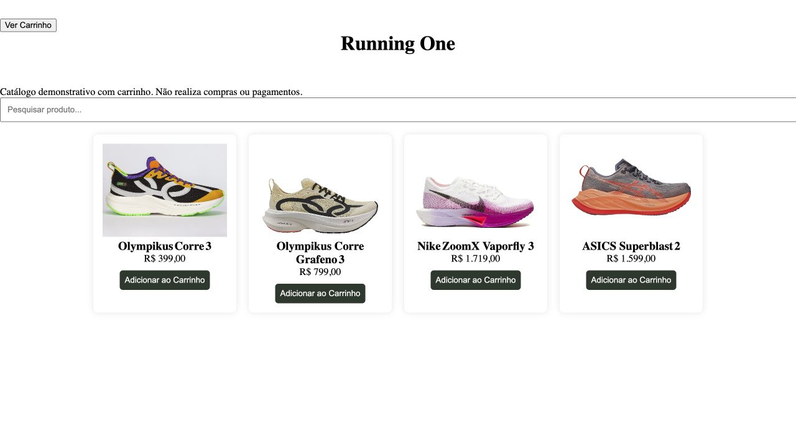

# RunningOne — Catálogo e carrinho

Simulação de catálogo de tênis com busca, carrinho, quantidade e total em reais.

## Tecnologias

HTML, CSS e JavaScript, sem instalação de dependências para executar.

## Executar

Baixe os arquivos e abra `index.html` em um navegador moderno. Mantenha todos os arquivos na mesma pasta. Também é possível servir a pasta com um servidor HTTP local.

## Verificar os fluxos

1. Pesquise por Nike e confira a filtragem.
2. Adicione produtos e abra o carrinho.
3. Aumente e diminua quantidades, remova itens e confira o total.

## Escopo e limitações

Os produtos são demonstrativos. Não há checkout, pagamento, autenticação ou persistência do carrinho. Marcas e imagens são usadas no contexto do estudo; não há vínculo comercial declarado.

## Origem

Projeto de estudo de [Abner Gabriel](https://github.com/Abnergabrel), separado da pasta [RunningOne](https://github.com/Abnergabrel/JavaScript/tree/main/RunningOne) para apresentação independente. Esta versão recebeu ajustes de funcionamento e documentação. O material original permanece preservado.
